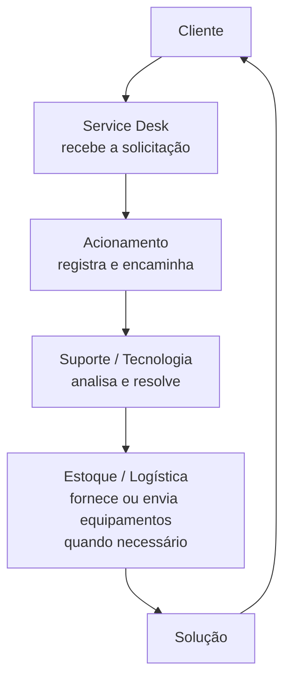

# TechSupport Solutions

Projeto acadêmico de **Gestão de Sistemas** que simula o funcionamento de uma empresa de Tecnologia da Informação e mostra como a tecnologia mantém cada setor funcionando de forma integrada.

Cada disciplina aplica seus conhecimentos dentro da empresa: **Arquitetura**, **Sistemas Operacionais**, **Redes** e **IoT**.

## 🏢 A empresa

**TechSupport Solutions** é uma empresa de TI voltada para suporte técnico, infraestrutura, manutenção, logística e atendimento empresarial.

**Principais serviços**

- Venda e manutenção de equipamentos
- Instalação de sistemas e redes
- Suporte técnico e Service Desk
- Gerenciamento de servidores
- Controle de estoque e logística

**Funcionamento:** segunda a sexta, das 8h às 18h, com suporte estendido conforme a necessidade.
**Total de funcionários:** 50

| Unidade | Departamentos |
|---------|---------------|
| **Matriz** | Administração, Financeiro/RH, Logística/Estoque e Acionamento |
| **Filial 1** | Tecnologia, Manutenção, Suporte Técnico e Service Desk |
| **Filial 2** | Redes, Infraestrutura e Servidores |

### Tecnologia nos departamentos

| Departamento | Recursos e função |
|--------------|-------------------|
| Gestão/Administração | Computadores e sistemas para organização e gestão |
| Financeiro/RH | Sistemas para controle financeiro e de funcionários |
| Logística/Estoque | Sistema de estoque, leitores e impressoras para controle de equipamentos |
| Acionamento | Sistema de chamados para registrar e encaminhar solicitações |
| Tecnologia/Manutenção | Computadores e ferramentas para configuração e manutenção |
| Suporte Técnico | Sistemas e acesso remoto para solucionar problemas |
| Service Desk | Atendimento, registro e acompanhamento de chamados |
| Redes/Infraestrutura | Equipamentos de rede para garantir conectividade |
| Servidores | Gerenciamento de servidores, backup e monitoramento |
| Segurança/Qualidade | Recursos para segurança e controle dos serviços |

### Fluxo de atendimento

O Service Desk recebe o chamado, o Acionamento direciona a demanda, o Suporte e a Tecnologia solucionam o problema, enquanto Logística e Estoque fornecem os equipamentos necessários. Redes e Servidores mantêm a infraestrutura funcionando.

## 🗺️ Mapa das pastas

| Pasta | Conteúdo |
|-------|----------|
| [`empresa/`](empresa) | Descrição da empresa, organograma, departamentos e fluxo de atendimento |
| [`arquitetura/`](arquitetura) | Disciplina de Arquitetura: planilhas, diagramas e documentos |
| [`sistemas-operacionais/`](sistemas-operacionais) | Disciplina de Sistemas Operacionais: scripts, testes e documentos |
| [`redes/`](redes) | Disciplina de Redes: topologias, endereçamento e configurações |
| [`iot/`](iot) | Disciplina de IoT: projeto, código e **link do Tinkercad** |
| [`evidencias/`](evidencias) | Imagens, prints e comprovações do que foi feito |
| [`referencias/`](referencias) | Fontes e materiais consultados |

## 📚 Disciplinas

| Disciplina | Aplicação na empresa | Pasta |
|------------|----------------------|-------|
| Arquitetura | [descrever em uma frase] | [`arquitetura/`](arquitetura) |
| Sistemas Operacionais | [descrever em uma frase] | [`sistemas-operacionais/`](sistemas-operacionais) |
| Redes | [descrever em uma frase] | [`redes/`](redes) |
| IoT | [Monitoramento Temperatura] | [`iot/`](iot) |

## 🔗 Links

- 🎬 Vídeo (YouTube): *[adicionar link]*
- 🔌 Simulação IoT (Tinkercad): *[adicionar link]* (também disponível na pasta [`iot/`](iot))

## 📝 Convenções do repositório

- Arquivos editáveis (`.xlsx`, `.docx`, `.drawio`) ficam junto das versões exportadas (`.pdf`, `.png`).
- Nomes de arquivos claros e descritivos.
- Commits com mensagens que identificam o que foi feito ao longo do semestre.
- O repositório não contém nomes, RAs, senhas ou dados pessoais.

## 📄 Licença

Projeto acadêmico, sem fins comerciais.
